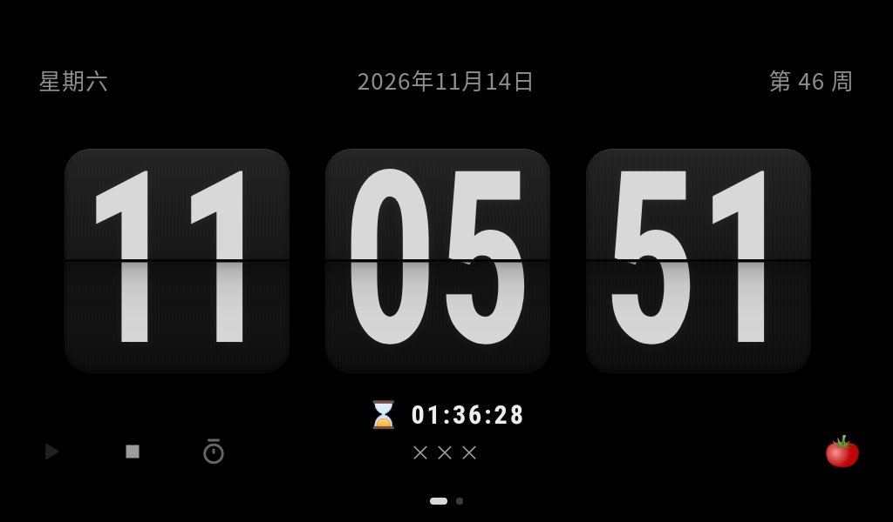
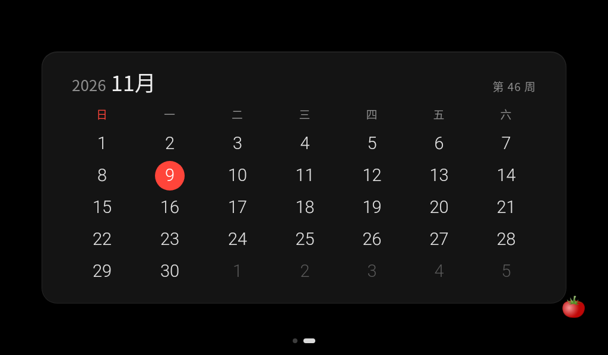
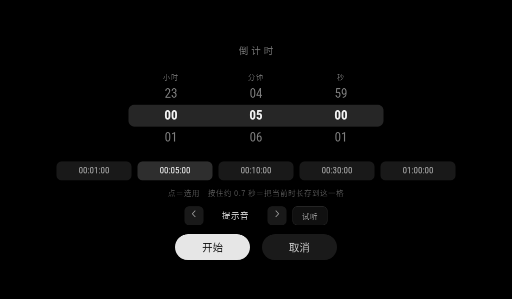
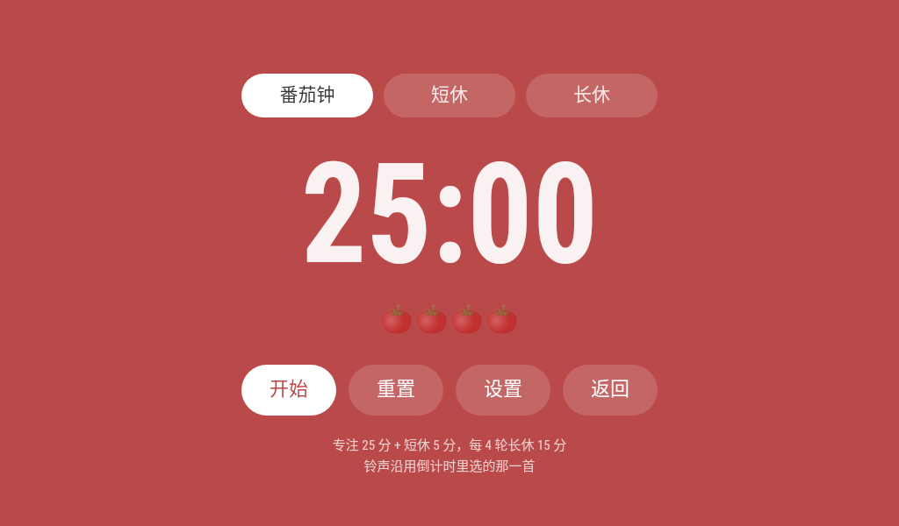
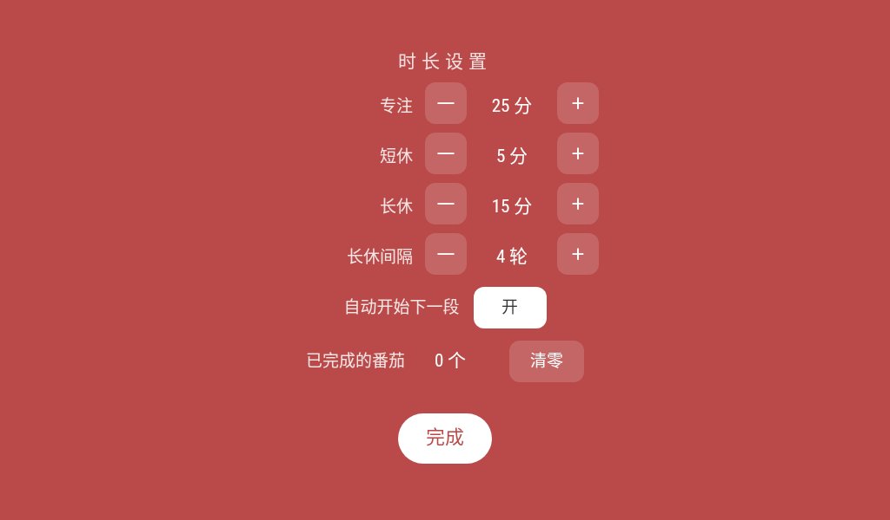

# 天猫精灵 TG_S1 → 常驻「时钟 / 日历 / 计时」信息屏

仓库地址：**https://github.com/negativesword/jingling-clock-modification**

一台 2019 年的带屏智能音箱（天猫精灵 CC / TG_S1），不刷 GSI、不改内核、不换固件，只靠 **Magisk systemless 覆盖 + 上层应用替换**，改造成一块通电即亮的桌面信息屏：翻页钟、农历日历、倒计时、番茄钟，全部离线、全部本地、断电重启自动回到时钟页。

> 本文是这套改造的完整复盘：做成了什么、为什么这么做、每一个"点不动 / 不出声 / 不生效"的坑根因是什么、以及怎么把它复制到另一台同型号设备上。

---

## 1. 成品是什么

| 能力 | 说明 |
| --- | --- |
| 翻页钟 | 时分秒三张翻页板质感卡片，276px 数字，iPad 深色风；日期行带农历与星期 |
| 日历 | 左右滑动切换第二页，月视图 + 农历 + 周数 |
| 倒计时 | 底部一行淡字点开面板；三列滚轮自定义时长、5 个可长按改写的快捷档、最后一分钟转红数秒、到点响铃；**误触刷新/被杀重启后接着跑**（绝对结束时刻落 `localStorage`，键 `cdState_v1`） |
| 番茄钟 | 右下角一个 🍅 图标点开面板：专注 / 短休 / 长休三段、轮次番茄、自动接力、四种时长可调、到点响铃 |
| 常驻性 | 断电冷启动 30 秒内自动进入页面；应用被杀 20 秒内拉起；HOME 键回不到原厂桌面 |
| 离线 | 页面单文件自包含，音频 base64 内嵌，不联网、不依赖任何在线资源 |

硬件底子：MT8167S / 7 寸 1024×600 / **1GB RAM + 512MB zram** / Android 8.1 (sdk 27) / 纯 armeabi-v7a / WebView 是 **Chrome 61 (61.0.3163.98)**。

下面全部是实机截图（1024×600，2026-11-09），页面用的是本仓库的 `page/index.html`：

| 时钟页（开机默认） | 日历页（左滑进入） |
| --- | --- |
|  |  |

| 倒计时面板 | 番茄钟专注态 | 番茄钟设置页 |
| --- | --- | --- |
|  |  |  |

> 这五张图是用**本仓库的 `page/index.html`**推上实机后拍的（拍摄时为 240,939 B；之后补了倒计时持久化，现为 242,206 B / md5 `c67bbded…`，界面没有变化）。验收链路：上屏 → 开倒计时面板 → 点「试听」（`dumpsys media.audio_flinger` 出现 1 条 active track，证明内嵌的合成提示音确实在响）→ 进番茄钟 → 设置页 → 返回时钟页，全部正常；验收完已把设备还原成它原来那版。
>
> 标语位置的公司名在发布版里换成了「×××」（页面 `.caption` 与截图是同一处改动，截图是匿名化后的页面重新上机拍的）。想要显示自己的名字，改 `page/index.html` 里 `<div class="caption">` 那行即可——注意它会改变文件体积与 md5。


---

## 2. 为什么是这套方案

这个设备上，主流做法全部走不通，逐条否掉之后才落到现在的方案：

| 方案 | 结论 | 原因 |
| --- | --- | --- |
| 刷 GSI / 完整 AOSP 移植 | 否 | 1GB 内存跑不动，且驱动全在厂商私有分区 |
| 硬改 `/system` 里的文件 | 否 | dm-verity 开着，改一个字节就 EIO 卡 logo 无限重启 |
| `pm disable-user` 卸载预装 | 否 | 该机型 `pm` 无此命令；强用会带崩 `system_server` |
| Device Owner + Lock Task | 否（评估后放弃） | 管理员一旦设定撤不掉；APK 在 Magisk 模块里，模块一丢就是"DPC 缺失"，8.1 只能恢复出厂，而 userdata 没备份 |
| 装新版豆包当桌面 | 否 | 403MB APK 在 1GB 机器上 dexopt 死循环，反复重启 |
| **Magisk systemless + 第三方 WebView kiosk** | **采用** | 不碰任何只读分区、可随时回滚、单文件页面迭代成本最低 |

一句话：**把"改系统"降级成"覆盖文件 + 换一个前台应用"**，风险面从"变砖"缩到"卸载模块即恢复"。

---

## 3. 架构

```
┌─────────────────────────────── 设备（Android 8.1, 1GB RAM） ───────────────────────────────┐
│                                                                                            │
│  ① Magisk systemless 模块 infoscreen                                                        │
│     ├─ system/app/WebviewKiosk/WebviewKiosk.apk   ← 全屏 WebView 容器（第三方，不入库）        │
│     ├─ system/etc/clock.html   ← bind mount 到 /system/etc/clock.html（改页面免重启）          │
│     └─ service.sh              ← 看门狗：20s 判活、60s 判前台                                 │
│                                                                                            │
│  ② 系统层：package-restrictions.xml 里组件级禁用两个原厂 HOME Activity                          │
│     children/…AdultHomeActivity、smartapp/…BootHomeActivity → HOME 只剩 kiosk                 │
│     （整包不能隐藏：SettingsProvider 依赖 smartapp 的 DataCenterProvider，会连锁重启）           │
│                                                                                            │
│  ③ debloat 模块：13 个 0 字节占位 APK，压掉视频/相册/浏览器/OTA 等预装                           │
│     语音四件套（唤醒/ASR/TTS/NLU）保留                                                        │
│                                                                                            │
│  ④ uk.nktnet.webviewkiosk：file:///system/etc/clock.html，沉浸全屏、常亮、唤醒刷新、锁定启动      │
│                                                                                            │
└────────────────────────────────────────────────────────────────────────────────────────────┘
                                    │
                          单文件页面 clock.html（约 240 KB：代码 + 一段自制合成提示音）
                          时钟页 ⇄ 日历页（左右滑），全屏面板叠在页面上
```

页面本身只有一条硬约束：**必须在 Chrome 61 上活**。这条约束支配了后面所有的取舍（见 `docs/PITFALLS.md`）。

---

## 4. 目录结构

```
tg-s1-infoscreen/
├─ README.md              本文件：方案总览与结论
├─ PUBLISH.md             发布到 GitHub 前的检查清单与命令
├─ LICENSE                MIT（仅覆盖本仓库代码与文档，不含第三方素材）
├─ docs/
│  ├─ DEPLOY.md           部署手册（备份 → Magisk → kiosk → HOME 接管 → 精简 → 验收）
│  ├─ PITFALLS.md         踩坑清单：现象 / 根因 / 修法（按 A~F 分组）
│  ├─ PAGE-SPEC.md        页面规格：版式尺寸、坐标、颜色、函数、localStorage 键
│  ├─ VERSION_LOG.md      v1 → v22c 演进史与每次取舍的理由
│  └─ images/             实机截图（本 README 里引用的那六张）
├─ page/
│  ├─ index.html          页面本体（开箱即用，已内置一段自制合成提示音）
│  └─ README.md           页面说明：怎么改、怎么推、铃声音频怎么自带
├─ assets/
│  └─ chime.wav           合成提示音的 WAV 源文件（与 page 内嵌的是同一段）
├─ module/
│  ├─ README.md           Magisk 模块的结构与 module.prop 要点
│  ├─ service.sh          看门狗参考实现
│  └─ system/etc/         clock.html 的放置点（由 page/index.html 提供）
└─ tools/
   ├─ make_chime.py       合成这段提示音（纯正弦，MIT 可分发）
   ├─ pack_ringtones.py   把自有版权音频内嵌进页面（生成 RINGS 数组）
   └─ deploy-page.ps1     改页面 → 推送 → force-stop → 等首渲 → 截图 的一键脚本
```

> **注意**：本仓库刻意**不包含**原厂固件、第三方 APK、以及任何商业铃声。原因见第 8 节。

---

## 5. 快速开始（同型号设备）

完整步骤在 `docs/DEPLOY.md`，这里是主线：

1. **备份**。先备份 21 个分区（本机实测 1551.5 MB）。`userdata` / `cache` 不在备份里，所以后面任何"可能触发恢复出厂"的方案一律不碰（这就是放弃 Device Owner 的直接原因）。
2. **装 Magisk**（patch 官方 boot.img，只动 boot，不动 system/vendor）。
3. **建 systemless 模块** `infoscreen`：放 kiosk APK + `clock.html` + `service.sh`，重启一次生效。
4. **禁原厂 HOME**：`package-restrictions.xml` 的 `disabled-components` 里加两个组件，`chown system:system`、`chmod 660`、`chcon u:o:system_data_file:s0`，然后 `kill $(pidof system_server)`（**不要正常关机**）。
5. **kiosk 设首页**：设置 UI 里把 URL 改成 `file:///system/etc/clock.html`，必须用 "Use the current URL" 按钮落盘；开沉浸全屏 / 常亮 / 唤醒刷新 / 锁定启动。
6. **精简**：debloat 模块放 13 个 0 字节占位；**语音四件套保留**；`smartapp` 不能整包隐藏。
7. **验收**：物理断电冷启动三次，确认每次都自动进时钟页；`cmd package query-activities --brief -a android.intent.action.MAIN -c android.intent.category.HOME` 应只剩 kiosk 与 FallbackHome。

日常改页面（**不需要重启**）：

```
改本地 page/index.html
  → 传到 /data/adb/modules/infoscreen/system/etc/clock.html（bind mount 立即生效）
  → 同步一份到 /sdcard/clock/index.html（留底，也是断电后的恢复源）
  → su -c 'am force-stop uk.nktnet.webviewkiosk'
  → 等首渲完成再 screencap（240 KB 页面约 8~10 秒；5.5 MB 页面要 32~38 秒，su 的 Toast 还会遮一下画面）
```

**注意：这台机器上 `adb push` / `adb pull` / `adb install` 全都会崩在 `file_sync_client.cpp:477 protocol fault`**，所以传输不能走 adb 的文件同步通道。两个可用的替代（都验证过）：

```powershell
# ① base64 走 adb shell 的 stdin（不依赖本机 IP，最省事）
$b64 = [Convert]::ToBase64String([IO.File]::ReadAllBytes('page/index.html'))
$b64 | & adb -s <device-ip>:5555 shell "su -c 'base64 -d > /data/local/tmp/repo.html'"
& adb -s <device-ip>:5555 shell "su -c 'cp /data/local/tmp/repo.html /data/adb/modules/infoscreen/system/etc/clock.html'"

# ② PC 起 TcpListener + 设备端 toybox nc 回连（见 tools/deploy-page.ps1）
```

传完一定 `md5sum` 对账。**`nc > 文件` 这种重定向会在连上之前就把目标文件截成 0 字节**，如果设备没连到 PC，页面会直接变成空白屏——这是本仓库踩过的坑，见 `docs/PITFALLS.md` E6。

`tools/deploy-page.ps1` 把"传输 + force-stop + 等待 + 截图"包成了一步。

---

## 6. 这台设备真正教会我们的 10 条经验

完整版在 `docs/PITFALLS.md`，这里是复用价值最高的十条：

1. **先确认能不能接管 HOME，再谈做信息屏。** 厂商定制机很可能有两个 HOME Activity（启动页 + 主桌面），要组件级禁用而不是整包禁用；整包隐藏会把 `SettingsProvider` 带崩，被 MTK AEE 升级成重启。
2. **只读分区一律不碰，全部走 systemless。** "改一个字节就 EIO 卡 logo"不是传说，这台机器上一次就够。
3. **WebView 版本决定设计法。** Chrome 61 = 没有 flex `gap`、`transform` 要 `-webkit-` 前缀、`<audio>` 整条通道作废、长按 500ms 会弹系统选字菜单、多段 `<script>` 之间全局函数互相看不见。先把这些查清，再动手画界面。
4. **"点不动"九成是命中测试，不是位置。** 空心 SVG 只有描边像素可点（`pointer-events:visiblePainted`），必须让父容器接管；全宽 fixed 覆盖层会吃掉底部整条带的点击。
5. **触摸事件不要单押一路。** 这台机器上 click 和 touchend 会随机缺一路，所有入口都走 `click + touchend` 双通道 + 400ms 去重。
6. **长按要"到点即触发"，不能等松手。** 系统长按菜单会在 500ms 抢走事件、touchend 可能永远不来：双路判定（touchstart 起 650ms 定时器直接执行，touchend 晚到再兜一次），`touchmove` 只在位移 >20px 时才取消。
7. **面板关闭后要挡住"迟到的 click"。** 面板隐藏瞬间，同一点位的合成 click 会打到底层整行热区，表现为"点返回却弹出另一个面板"。用关闭时间戳 + 700ms 冷却。
8. **老 WebView 里声音只有 WebAudio 一条路。** `new Audio()` 连系统自带 ogg 都报 `NotSupportedError`；正确解是 base64 内嵌 + `decodeAudioData` + `AudioBufferSourceNode`，并且必须在用户手势里 `audioWake()` 把上下文 resume 到 `running`，否则 start 了也不出声。听不见的情况下用 `dumpsys media.audio_flinger` 的 `active track` 证明真的在响。
9. **改产物永远先留退路。** 每次改页面先复制到 `_backup/`；改 `package-restrictions.xml` 先 base64 取回、`[xml]` 校验、再回写并修权限与 SELinux 上下文。
10. **调试层不要留在产物里。** 用 localStorage 当临时事件日志（写进去再从 leveldb 取回）是这台无调试通道设备上最好的探针，但收尾必须把探针、`window.onerror`、日志键全部拆干净。

---

## 7. 版本演进（一句话摘要）

| 版本 | 主题 | 关键取舍 |
| --- | --- | --- |
| v1 | 单页时钟 | 起步基线 |
| v2 | 双页 iPad 浅色 | 未留档，很快被深色取代 |
| v3 | 深蓝翻页钟 | 确立"翻页板"方向 |
| v9 | 翻页板质感 | 五层结构：渐变卡片 / 竖纹 / 遮罩 / 缝 / 数字 |
| v10–v11 | 倒计时 + 三列滚轮 | 从"几个按钮"升级成"自定义时长" |
| v12–v14 | 左下角图标、快捷格、图标热区 | 命中测试三连坑 |
| v15 | 统一 `hh:mm:ss` | 主界面与面板显示口径一致 |
| v16 | 图标与公司名放大 | 可点性优先于留白 |
| v18 | 铃声 | 四条路三条全废，最终 WebAudio |
| v19–v20 | 五格 + 长按修复 | 双路判定替代单押 touchend |
| v21 | 番茄钟 | 主界面只放一个 🍅，功能全进面板 |
| v22 | 番茄钟配色 + 放大 | 取 pomofocus 三色；白底主按钮字色跟页面走 |

细节与理由见 `docs/VERSION_LOG.md`。

---

## 8. 合规、版权与风险（发布前必读）

- **商业铃声不要入库。** 改造过程中试过内嵌七首 iOS 系统铃声（版权属 Apple，随页面分发就是再分发），**仓库版已全部剔除**，换成本仓库自己合成的 `assets/chime.wav`（988Hz + 1319Hz 正弦，纯数学合成，16kHz/16bit/mono，约 4.4 秒，随 MIT 分发）。想要别的铃声，用 `tools/pack_ringtones.py` 把**你自己合法持有的音频**编进去，生成物留在本地、不要提交。
- **铃声不是必须的。** 就算一段音频都不内嵌，倒计时与番茄钟也会在 1.5 秒内回落到 `beepLoop()`（WebAudio 直接振荡 880×2 + 1046），保证到点一定有声——这是剥离铃声后专门补的兜底。
- **第三方 APK 不要入库。** `WebviewKiosk`（`uk.nktnet.webviewkiosk`）是别人的作品，仓库只写"从官方渠道自行安装"，不附 APK、不附镜像。
- **原厂固件/分区镜像不要入库。** 既涉及厂商版权，也涉及设备唯一标识。
- **刷机有风险。** boot patch、systemless 模块、禁用系统组件都可能让设备进不了系统；本仓库的操作步骤是按一台实机验证出来的，不代表在你的设备上一定成立。请先备份，且明白 `userdata` 没备份就等于"恢复出厂 = 丢数据"。
- **本文档不含任何可以绕过设备安全机制的内容**，只描述在有物理设备、且由设备所有者自行操作的前提下如何替换前台应用与页面。

---

## 9. 许可

本仓库的代码与文档以 MIT 发布（见 `LICENSE`）。第三方素材、系统铃声、厂商固件、第三方 APK 均不在授权范围内。

## 10. 致谢

界面方向的参考：iPad 时钟、FlipKlok（翻页板质感）、pomofocus.io（番茄钟配色与面板结构）。它们是视觉参考，不是素材来源。
